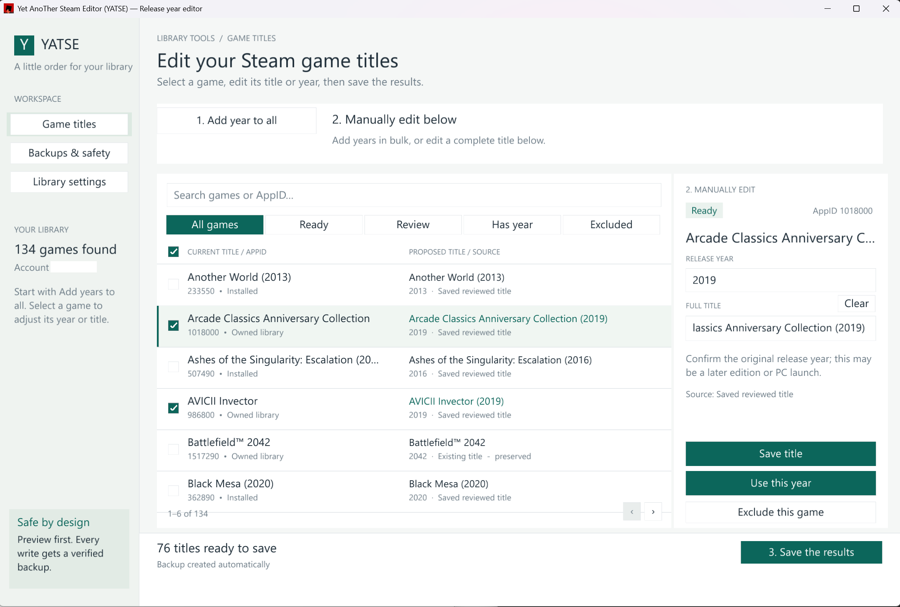
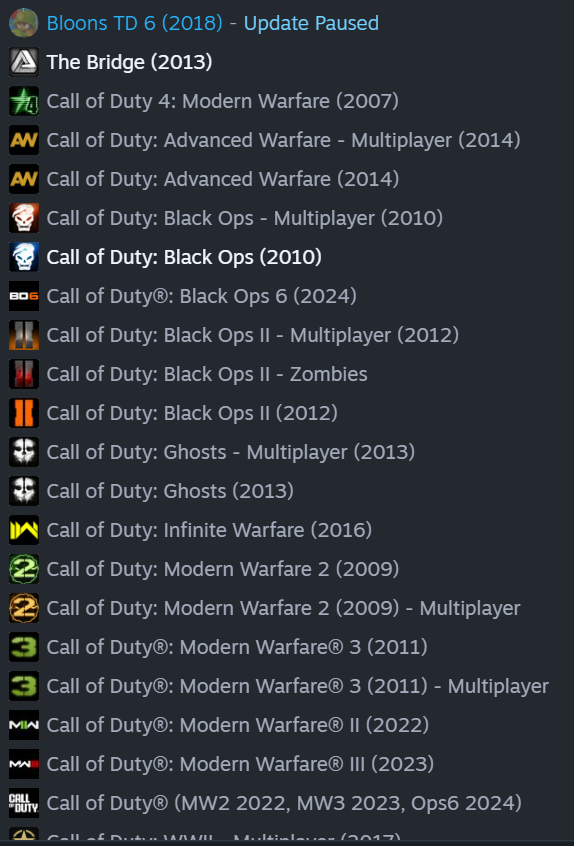
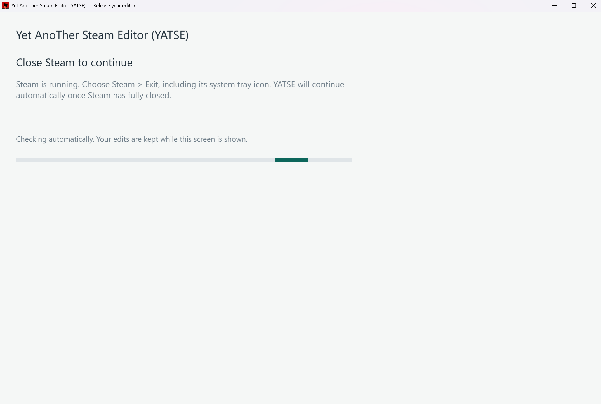

# YATSE — Yet AnoTher Steam Editor

**Make your Steam library easier to navigate.**

Ever struggled to figure out which COD *Modern Warfare 3* and *Modern Warfare III* game is which? With so many sequels, reboots, and similarly named games, finding the right game in your Steam library can be confusing.

That's why I created **YATSE**.

YATSE is a small Windows utility that lets you **change the displayed titles of games in your local Steam library**.

It was originally designed to automatically add release years to game titles, but you can customize the entire title however you like.

## What can YATSE do?

- **Automatically add release years** to game titles.
- **Rename games freely** to make their names more meaningful.
- **Organize confusing game series** such as Call of Duty, DOOM, or Tomb Raider.
- **Keep changes local** — YATSE changes how titles appear in your Steam library, not the official game names on Steam.

For example, instead of seeing just `DOOM`, you can display `DOOM (2016)`. Or give games in a confusing series your own consistent naming scheme.

## The editor

YATSE provides a simple interface for browsing your games and editing their titles.

## The result in Steam

Once the titles are updated, your Steam library becomes easier to browse. Release years help you quickly identify games, especially when multiple entries share similar names.

Yatse comes with Steam running detection and with Steam metadata change detection.

## Download & usage

Download the Windows x64 executable from [GitHub Releases](https://github.com/bkersbergen/yatse/releases).

1. Download and run `yatse.exe`.
2. Close Steam if it's running. YATSE will wait for Steam to close.
3. Edit your game titles or automatically add release years.
4. Reopen Steam to see your updated library.

Settings and backups are stored alongside the executable.

## Important notes

YATSE modifies local Steam metadata. It does not rename games on your Steam account or change their official titles.

Steam may overwrite local customizations when it updates its metadata.

**Use at your own risk.**

YATSE is an independent project and is not affiliated with Valve or Steam.
